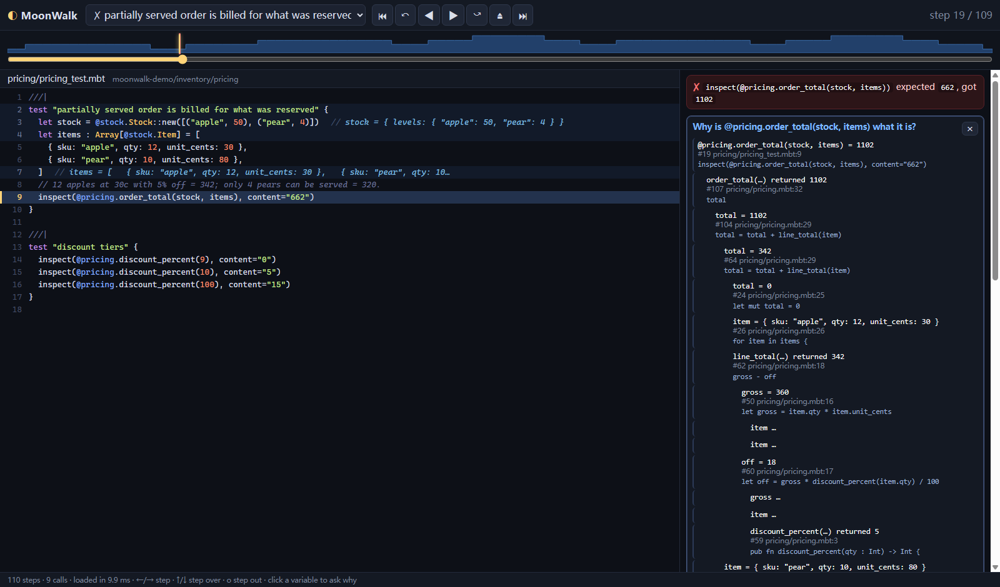

# MoonWalk 🌗

**An omniscient (time-travel) debugger for MoonBit.**
Record a failing test once, then move backwards and forwards through every step it took, and ask *why* any value is what it is.

[](https://github.com/wangzh12023/moonwalk/actions/workflows/ci.yml)
[](LICENSE)

[中文说明](README.zh.md) · [Architecture](docs/ARCHITECTURE.md) · [Examples](examples/)



```text
$ moonwalk why -C examples/bank
bank_test.mbt:7: inspect(acc.balance) expected "298", got "296"

why is acc.balance what it is at step #39?

self.balance = 296
    #32 bank.mbt:37  self.balance = self.balance - amount - fee * 2
  self = { owner: "ada", balance: 500, history: [500] }  (argument)
  amount = 200  (argument)
  fee = 2
      #28 bank.mbt:33  let fee = fee_for(amount)
    fee_for(...) returned 2
        #26 bank.mbt:24  amount / 100
      because this condition was true
          #24 bank.mbt:23  if amount > 100 {
```

The fee is 2, and it is subtracted twice (`fee * 2`). MoonWalk found that by following the recorded data flow; nobody added a `println`.

## Why

MoonBit compiles to wasm-gc, JavaScript and native code. Most of its users run tests on wasm-gc, where there is **no debugger at all**: no breakpoints, no stepping, no inspecting a variable. When a test fails, the workflow is to sprinkle `println`, re-run, read the output, and repeat.

Classic debuggers would not fix this even if they existed. They only go forward, so once you have stepped past the moment a value went wrong you start over. And the question you actually have is rarely *"what is `x` now?"*. It is *"how did `x` get this value?"*.

That question matters more every month. Code increasingly comes from AI assistants, and a failing test in code you did not write is the most common place a developer needs to *understand* a program quickly.

MoonWalk answers the second question directly:

* **Record once, explore forever.** Every statement, call, argument, return value, branch decision and assignment of a test is recorded. You can step forwards *and backwards*, step over and out, and jump to any moment.
* **Ask why.** Click a value, or run `moonwalk why`, and get its *provenance*. That is the assignment that produced it, the variables and calls it depended on, and the `if`/`match` decisions that made it happen, across function boundaries. This is dynamic slicing, computed from the actual run.
* **No setup.** It works on any MoonBit module without changing a line of it, on every backend `moon test` supports. It needs no compiler plug-in and no debug symbols.
* **For humans and for AI agents.** There is a terminal transcript, a standalone HTML time-travel viewer, and an [MCP](https://modelcontextprotocol.io) server. With the MCP server, Claude Code, Cursor or Codex can query the execution history instead of guessing.

## Install

Requires the [MoonBit toolchain](https://www.moonbitlang.com/download).

```bash
git clone https://github.com/wangzh12023/moonwalk
export PATH="$PWD/moonwalk/bin:$PATH"     # Windows: add moonwalk\bin to PATH
moonwalk --help                           # builds the CLI on first use
```

MoonWalk is a MoonBit program compiled to WebAssembly and run by `moonrun`, which ships with the toolchain. It runs on Linux, macOS and Windows. The launchers `bin/moonwalk` and `bin/moonwalk.cmd` build it on first use. You can also build it yourself with `moon build cmd/moonwalk --target wasm --release`.

## Usage

Run these inside a MoonBit module, or pass `-C <module-root>`.

| Command | What it does |
|---|---|
| `moonwalk list` | List the tests of the module. |
| `moonwalk record [TEST]` | Record a test and print its execution as an indented transcript. `TEST` is a name, part of a name, or `file:line`. |
| `moonwalk record TEST --html run.html` | Also write a **standalone time-travel viewer**: one offline HTML file to open in any browser or attach to a bug report. |
| `moonwalk record TEST --json run.json` | Also write the full recording as JSON. |
| `moonwalk why [TEST]` | Explain the value checked by the failing `inspect`. |
| `moonwalk why TEST --var acc.balance --step 25` | Explain any variable or field at any step. |
| `moonwalk mcp` | Serve the tools below to AI coding agents over stdio. |

Common options are `--target wasm-gc|wasm|js`, `--max-events N` (default 200 000), and `--timeout SECONDS`.

### The time-travel viewer

`--html` writes a single page that needs no server and no network:

* **Timeline scrubber** shows the call depth over the whole run, with the failing check marked. Drag it to travel in time.
* **Source view** highlights the current line, marks executed lines, and shows **inline values** next to the code.
* **Keyboard**: `←`/`→` steps, `↑`/`↓` steps over calls, `o` steps out, and `Home`/`End` jump to the start or end.
* **Variables**: click one to see **why** it has that value. Each cause links to the step where it happened.
* **Call stack**: click a frame to jump to its call.

The viewer is itself written in MoonBit with [rabbita](https://github.com/moonbit-community/rabbita), and it runs the same `why` engine as the CLI.

### AI agents (MCP)

```jsonc
// Claude Code: .mcp.json in your project
{
  "mcpServers": {
    "moonwalk": {
      "command": "moonrun",
      "args": ["/path/to/moonwalk.wasm", "--", "mcp"]
    }
  }
}
```

The server provides these tools:

* `list_tests`
* `record_test`: outcome, the failing check, and a call tree with arguments and results.
* `explain_value`
* `state_at_step`
* `variable_history`
* `line_visits`

An agent records the failing test once and then asks precise questions, instead of editing code to add prints and re-running it.

## How it works

```
your module ──moonbitlang/parser──▶ instrumented shadow copy ──moon test──▶ probe events
                                    (_build/moonwalk/shadow)                     │
   transcript / why / HTML viewer / MCP ◀── timeline + dynamic slicing ◀────────┘
```

1. **Instrument.** Every `.mbt` file is parsed with the official [`moonbitlang/parser`](https://github.com/moonbitlang/parser). Probe calls are inserted as text edits at AST positions: function entry and exit (through `defer`, so raising exits are recorded too), statements, bindings, branch decisions, match arms and return values. **No line breaks are ever inserted**, so line numbers in the instrumented copy match your source.
2. **Repair.** Values are rendered through the core `Debug` trait. When a type does not implement it, the compiler error is mapped back to the probe that caused it, and that value is shown as `<hidden>`. Then the copy is rebuilt.
3. **Run.** The selected test runs in isolation (`moon test -p … --file … -i …`) with a timeout. Probe events stream out on stdout behind a `\u0001MW` marker. The stream is plain lines, so a panicking or looping test still leaves a valid recording.
4. **Explain.** Events become a timeline of frames and steps. `why` walks it backwards. Reads lead to the last write. Calls lead to their return expression. Parameters lead to the caller's argument. Field writes made through `self` inside a method lead back to the caller's variable. Every step is linked to the branch decision that guarded it.

More detail is in [docs/ARCHITECTURE.md](docs/ARCHITECTURE.md).

## Limits

These are deliberate scope boundaries:

* MoonWalk records **tests**. Programs with `fn main` work through a test that calls them.
* It traces the code of the **module being debugged**. Calls into dependencies, including `moonbitlang/core`, appear as single steps whose results are recorded.
* Values are snapshots rendered with `Debug`, at depth 6 by default. Closures, values of generic types, and types without `Debug` are shown as `<hidden>`.
* Aliasing is tracked by variable and field paths. A mutation reached through another alias, such as an element pulled out of an array and mutated elsewhere, is explained up to that alias.
* Recording costs roughly 2–5× test run time, plus one extra compilation of the module.

## Development

```bash
moon check --target all
moon test --target wasm-gc        # also: --target wasm, --target js
scripts/build-viewer.sh           # after changing cmd/viewer or the viewer model
moon run cmd/mw-instr -- file.mbt # print the instrumented form of a file
```

The module is split into packages:

* `src/model`: sites and source text.
* `src/instrument`: the parser-driven rewriter.
* `src/trace`: timeline, navigation, and the `why` engine.
* `src/project`: module discovery, shadow build, and running tests.
* `src/report`: the text and JSON views.
* `src/viewer`, `cmd/viewer`, `src/highlight`, `src/html`: the browser viewer.
* `cmd/moonwalk`: the CLI and the MCP server.

## Credits and license

MoonWalk is original work. It builds on:

* [`moonbitlang/parser`](https://github.com/moonbitlang/parser) (Apache-2.0) for parsing MoonBit source and `moon.mod`/`moon.pkg` files.
* [`moonbitlang/async`](https://github.com/moonbitlang/async) (Apache-2.0) for processes and file I/O.
* [`moonbitlang/x`](https://github.com/moonbitlang/x) (Apache-2.0).
* [`moonbit-community/rabbita`](https://github.com/moonbit-community/rabbita) (Apache-2.0) for the viewer UI.

The ideas follow the omniscient-debugging literature: Bil Lewis's *Omniscient Debugging*, *Whyline* by Ko and Myers, and dynamic slicing by Agrawal and Horgan. The implementation shares no code with any of them.

Licensed under the [Apache License 2.0](LICENSE).
